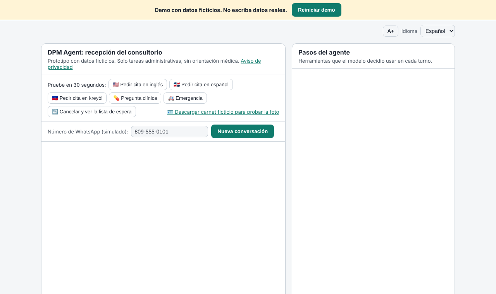
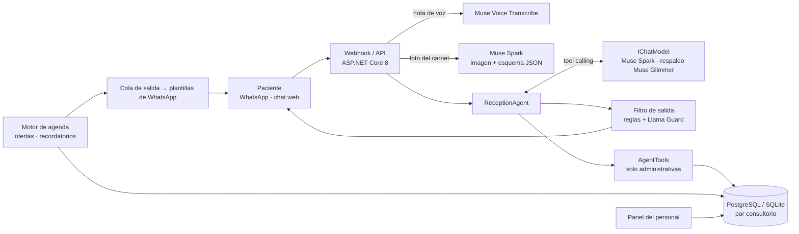

# DPM Agent

*English version: [README.md](README.md)*

**Una recepción por WhatsApp para consultorios dominicanos, construida sobre los modelos Muse de Meta: agenda, reprograma y llena los turnos cancelados en español, inglés y kreyòl haitiano, y nunca da consejo médico.**



<!-- CAPTURA: reemplazar por un GIF de una conversación real con Muse Spark (nota de voz → cita → oferta de lista de espera) -->

> Proyecto para el **Meta AI Developer Hackathon** (26 oct – 4 nov 2026), categoría Indie Developer. Cómo cumple cada regla del hackathon, de WhatsApp y de privacidad: [docs/es/REGLAS.md](docs/es/REGLAS.md).

---

## El problema

En muchos consultorios dominicanos la agenda vive en WhatsApp y el teléfono. La secretaria contesta los mismos mensajes todo el día ("¿hay turno mañana?", "¿la doctora atiende el sábado?", "quiero cambiar mi cita") mientras atiende a los pacientes en la sala de espera, llena formularios de la ARS y cobra. Los mensajes quedan sin respuesta, se pierden pacientes y los turnos cancelados quedan vacíos.

El país tiene además una gran comunidad haitiana, y muchos pacientes escriben en kreyòl. La mayoría de las herramientas de recepción solo hablan español.

En el consultorio piloto:

| Medida | Valor |
|---|---|
| Mensajes de WhatsApp por día en la recepción | <!-- CIFRA PILOTO: mensajes de WhatsApp por día --> *pendiente* |
| Parte de esos mensajes que son sobre citas | <!-- CIFRA PILOTO: % de mensajes sobre citas --> *pendiente* |
| Turnos cancelados por semana que quedan vacíos | <!-- CIFRA PILOTO: huecos por semana sin llenar --> *pendiente* |
| Pacientes que escriben en kreyòl o inglés | <!-- CIFRA PILOTO: % de pacientes en kreyòl o inglés --> *pendiente* |

DPM Agent se encarga de la conversación repetitiva y le deja al personal lo que de verdad necesita a una persona.

## Qué hace

- **Agenda, reprograma y cancela** por WhatsApp o chat web, con tool calling de varios pasos (buscar paciente → ver disponibilidad → confirmar → agendar). El servidor lo valida todo: no se puede reservar un turno ocupado o pasado aunque el modelo lo intente.
- **Habla el idioma del paciente**: español, inglés y kreyòl haitiano garantizados (textos fijos, plantillas de WhatsApp y pruebas en los tres); cualquier otro idioma se atiende lo mejor posible con el inglés como respaldo. El idioma se detecta en cada mensaje y se sigue si el paciente cambia.
- **Notas de voz** transcritas con Muse Voice Transcribe; el audio nunca se guarda.
- **Carnet de la ARS por foto**: Muse Spark lee nombre, ARS y número de afiliado (imagen + esquema JSON); el resultado queda pendiente hasta que el paciente o la secretaria lo confirman.
- **Llena solo los turnos cancelados**: cuando alguien cancela, el primer paciente compatible de la lista de espera recibe la oferta por su canal; si no responde en 30 minutos, pasa al siguiente.
- **Recordatorio 24 horas antes**, con opción de confirmar o cancelar.
- **Seguimientos indicados por el médico** ("control en 3 meses"): si la fecha está cerca se agenda en el primer hueco de la ventana del médico; si está lejos, se contacta al paciente unas semanas antes para escoger horario, con reintentos y paso a la secretaria si no responde. Respeta feriados y los días libres del médico.
- **Canal propio del médico**: desde su WhatsApp verificado con un código de un solo uso, el médico indica seguimientos, ve su agenda del día, bloquea días libres y decide sobrecupos, y puede recibir cada mañana un resumen administrativo (solo con su propio permiso).
- **Familias y cambios de agenda**: un mismo teléfono puede gestionar a varios pacientes (hijos, padres); el agente pregunta para quién es, y vincular a uno nuevo pide confirmación. Si el médico bloquea un día, se contacta a cada paciente afectado con horarios nuevos (primero seguimientos y urgencias); si el médico va con retraso, se avisa a los pacientes que le quedan; tras una ausencia se ofrece reagendar una vez.
- **"Necesito que me vean hoy"**: sin preguntar síntomas ni juzgar la gravedad. El agente ofrece el primer hueco de hoy o del siguiente día hábil, incluidos los cupos de urgencia por médico; si no hay, crea una solicitud de sobrecupo que solo la secretaria o el médico pueden aprobar, y le comunica la decisión al paciente.
- **Todo lo clínico va a una persona**: las preguntas de salud se escalan con el mensaje original y un resumen en el idioma del panel; ante una posible emergencia indica el número de emergencias del consultorio (911 por defecto) y escala como urgente.
- **Panel del personal**: citas del día, escalamientos (urgentes primero), carnets por confirmar, borradores de autorización de ARS (nunca se envían solos), costo por conversación y por cita agendada, y la bitácora; el admin define el idioma predeterminado y el número de emergencias del consultorio. Español/inglés.
- **Varios consultorios**: cada registro lleva su consultorio y cada consulta se filtra por él.

## Cómo usa Meta AI

| Pieza | Modelo / producto de Meta | Dónde |
|---|---|---|
| Conversación y tool calling | **Muse Spark** (Meta Model API, `/v1/chat/completions`) | `Agent/ReceptionAgent.cs` |
| Lectura del carnet de la ARS | **Muse Spark**, imagen + salida estructurada | `Carnet/MetaLectorCarnet.cs` |
| Notas de voz | **Muse Voice Transcribe** | `Voz/MetaTranscriber.cs` |
| Respaldo o modo totalmente local | **Muse Glimmer** (pesos abiertos) con vLLM: Modal, Baseten o la GPU del consultorio | `Model/`, [docs/es/GLIMMER.md](docs/es/GLIMMER.md) |
| Filtro de seguridad de salida | **Llama Guard** (pesos abiertos) o el modelo Muse configurado como clasificador | `Seguridad/FiltroSalida.cs` |
| Juez de la evaluación | **Muse Glimmer** con una rúbrica escrita | `tools/DpmAgent.Eval`, [eval/RUBRICA.md](eval/RUBRICA.md) |
| Canal del paciente | **WhatsApp Cloud API** (webhook firmado, plantillas por idioma) | `Canales/WhatsApp/`, [docs/es/WHATSAPP.md](docs/es/WHATSAPP.md) |

## Resultados

### Evaluación

235 casos en 21 categorías (agendar, reprogramar, cancelar, paciente nuevo, carnet, lista de espera, pregunta clínica, emergencia, prompt injection, cita ajena, cambio de idioma, fuera de tema, transparencia, consentimiento, privacidad, seguimientos del médico, canal del médico, urgencias, familias y cambios de agenda, contacto, intentos de extraer datos) en español, inglés y kreyòl, más francés y portugués para el nivel 2. Dos capas: verificación determinista de herramientas y estado de la base, y un juez LLM con rúbrica. Ver [docs/es/EVALUACION.md](docs/es/EVALUACION.md).

**Contra Muse Spark:**

<!-- RESULTADOS MUSE SPARK: correr `dotnet run --project tools/DpmAgent.Eval -- --modelo real` y pegar aquí las tablas de eval/resultados/ -->
*Pendiente: requiere acceso a la Meta Model API.*

**Garantías del servidor (modelo guionado, corre en el CI en cada push):** 235 / 235 casos pasan — [último informe](eval/resultados/2026-10-26-modelo-falso.md). Algunos guiones simulan un modelo que obedece una inyección a propósito; aun así el servidor impide cancelar la cita de otro o cancelar sin la confirmación del paciente. El filtro de salida bloqueó las 5 respuestas guionadas con dosis y las 3 con código (fuera de tema).

### Costo

Cada llamada al modelo registra tokens de entrada y salida (nunca el contenido). Los precios se configuran por modelo, nunca en el código. Ver [docs/es/COSTOS.md](docs/es/COSTOS.md).

| Medida | Muse Spark |
|---|---|
| Costo promedio por caso de evaluación | <!-- COSTO MUSE SPARK: columna "Avg cost" del informe real --> *pendiente* |
| Costo promedio por cita agendada | <!-- COSTO MUSE SPARK: panel → Costos, tras la prueba piloto --> *pendiente* |

## Seguridad

- **Sin consejo médico.** El prompt lo prohíbe en todos los idiomas, no existe ninguna herramienta clínica, y un **filtro de salida** revisa cada respuesta antes de enviarla (reglas multilingües de dosis y medicamentos, y luego Llama Guard o el modelo como clasificador). Una respuesta bloqueada se reemplaza por un mensaje seguro, se escala y queda en la bitácora. Ver [docs/es/FILTRO-SALIDA.md](docs/es/FILTRO-SALIDA.md).
- **Emergencias**: se le indica al paciente que llame al número de emergencias del consultorio y el personal recibe un escalamiento urgente.
- **El agente nunca decide qué tan urgente es algo.** La prioridad la pide el paciente o la decide el personal; el agente solo la canaliza. Todo pedido urgente recibe el número de emergencias como texto fijo del servidor (no lo escribe el modelo), y fuera de horario los centros de emergencia del consultorio; un sobrecupo nunca lo aprueba el agente.
- **Solo un médico verificado obtiene herramientas de médico**: un admin registra el número y el médico lo confirma con un código de un solo uso desde ese teléfono; sus acciones (seguimientos, días libres, sobrecupos) van en dos pasos y solo se guardan datos administrativos, nunca diagnósticos.
- **Cada conversación solo actúa sobre su propio paciente**, identificado por el número del canal (el remitente de WhatsApp), nunca por lo que diga el modelo. La cita de otro se ve igual que una que no existe.
- **Defensa contra prompt injection en el servidor**: los resultados de herramientas, las transcripciones y el texto leído de fotos son datos. Cancelar toma dos turnos controlados por el servidor; un turno no puede hacer más de 3 acciones que cambian datos ni usar más de 5 herramientas; el motivo de la cita solo acepta valores administrativos.
- **Privacidad**: el audio y las fotos nunca se guardan; los logs no llevan datos de pacientes (probado); las conversaciones se borran a los 30 días (configurable); la secretaria puede exportar o borrar los datos de un paciente si lo pide. Ver [docs/es/PRIVACIDAD.md](docs/es/PRIVACIDAD.md).
- **Lo básico de producción**: panel con cookies seguras, claves con hash y bloqueo por intentos; límites por IP y por conversación; CSP y HSTS; health checks; claves solo en variables de entorno.
- **Accesibilidad**: el chat web, la demo, el aviso de privacidad y el panel pasan axe-core (WCAG 2.1 AA) en modo claro y oscuro en el CI; navegación completa con teclado y foco visible, etiquetas para lectores de pantalla, respuestas anunciadas al llegar y tamaño de letra ajustable (muchos pacientes son personas mayores).
- **Solo datos ficticios.** Todos los pacientes y médicos del repositorio son inventados.

## Seguridad informática

Los datos de un consultorio merecen más que la configuración por defecto de un prototipo. En resumen (detalles en [docs/es/ARQUITECTURA-SEGURIDAD.md](docs/es/ARQUITECTURA-SEGURIDAD.md), política de reporte en [SECURITY.md](SECURITY.md)):

- **Navegador**: Content-Security-Policy estricta sin scripts ni estilos en línea, `frame-ancestors 'none'`, `X-Frame-Options: DENY`, `Cross-Origin-Opener-Policy`, micrófono permitido solo en la página del chat; revisión CSRF de `Origin`/`Referer` en cada cambio del panel; sin CORS. El CI falla ante cualquier violación de la CSP en un navegador real.
- **Acceso al panel**: sesión de 30 minutos de inactividad y 8 horas como máximo, cierre de las otras sesiones al cambiar la clave, claves de 12 caracteres sin claves comunes, cambio obligatorio de la clave inicial, inicio de sesión que no revela qué usuarios existen, bloqueo por usuario y límites por IP, segundo factor TOTP opcional para administradores (el consultorio puede exigirlo) y una bitácora, solo para el admin, de quién vio, exportó o borró datos de pacientes.
- **Datos**: teléfono y número de afiliado del paciente cifrados en reposo con la Data Protection API (búsqueda por un HMAC); TLS obligatorio hacia PostgreSQL en producción (también en Docker Compose); audio y fotos nunca tocan el disco; una lista documentada y con diagrama de qué va a Meta, WhatsApp y Modal, y por qué.
- **Cadena de suministro**: gitleaks sobre todo el historial, CodeQL (C# y JavaScript), Trivy sobre la imagen Docker, Dependabot, acciones fijadas por SHA y permisos mínimos en los workflows; referencias a Key Vault y rotación de claves documentadas.
- **El propio agente**: no puede revelar datos de otros pacientes ni sus instrucciones; el filtro de salida lo frena aunque el modelo obedezca (categoría de evaluación `extraccion_datos`).

## Arquitectura



```
src/DpmAgent.Api/
  Agent/          ReceptionAgent, AgentTools, sesiones
  Idiomas/        detección de idioma, textos fijos es/en/ht
  Model/          clientes de Meta y compatibles con OpenAI, respaldo, uso
  Seguridad/      filtro de salida, límites, salud, logs, retención
  Agenda/         lista de espera, ofertas, recordatorios, cola de salida, bitácora
  Canales/        chat web y WhatsApp Cloud API
  Carnet/ Voz/    carnet de la ARS y notas de voz
  Panel/ Costos/  panel del personal y vista de costos
  Demo/           modo demo pública
  Data/ Dpm/      EF Core, migraciones por proveedor, gateway del consultorio
tools/DpmAgent.Eval/   evaluador      eval/   casos, rúbrica, resultados
tests/DpmAgent.Tests/  pruebas con un modelo guionado (sin llamadas reales)
```

## Probarlo

**Modo demo pública**: banner, ocho ejemplos de un clic (inglés, español, kreyòl, pregunta clínica, emergencia, cancelar con lista de espera, "que me vean hoy" y el médico pidiendo un control desde su número verificado), seguimientos sembrados (uno en 6 meses y otro que se abre hoy), la traza de herramientas del agente y un botón de reinicio que solo toca el consultorio de demo. Ver [docs/es/DEMO.md](docs/es/DEMO.md).

```bash
export META_API_KEY="su-clave"
export Demo__Habilitado=true
dotnet run --project src/DpmAgent.Api
```

**Docker Compose**: app + PostgreSQL, con un perfil opcional que corre Muse Glimmer en una GPU local. Ver [docs/es/INSTALACION.md](docs/es/INSTALACION.md).

```bash
cp .env.example .env    # META_API_KEY, POSTGRES_PASSWORD, Panel__ClaveInicial
docker compose up -d --build
# con Muse Glimmer local:
docker compose --profile glimmer up -d --build
```

**Pruebas y evaluación** (sin clave):

```bash
dotnet test
dotnet run --project tools/DpmAgent.Eval            # modelo guionado
dotnet run --project tools/DpmAgent.Eval -- --modelo real   # Muse Spark + juez
```

Con la clave de Meta, `./scripts/probar-meta.sh` y `dotnet test --filter "Categoria=Meta"` confirman los formatos reales ([docs/es/PRUEBAS-META.md](docs/es/PRUEBAS-META.md)). La prueba de PostgreSQL corre cuando `DPM_TEST_POSTGRES` apunta a una base desechable (el CI la provee).

Todos los ajustes, con su valor por defecto, están en [.env.example](.env.example). Componentes de terceros y sus licencias: [THIRD_PARTY_NOTICES.md](THIRD_PARTY_NOTICES.md) (verificado en el CI). Despliegue en Azure App Service con PostgreSQL y GitHub Actions: [docs/es/DESPLIEGUE.md](docs/es/DESPLIEGUE.md).

## Qué existía antes del evento y qué se hizo durante

**Antes del 26 de octubre de 2026:** DPM, mi sistema de gestión de consultorios (un repositorio privado aparte). Ese sistema **no** forma parte de esta entrega ni de la demo, y no se copió código de él.

**Durante el hackathon (todo lo que está en este repositorio):** el agente y sus herramientas, los clientes de la Meta Model API, el soporte multilingüe, las notas de voz, la lectura del carnet, la lista de espera y los recordatorios, WhatsApp, el panel del personal, el filtro de salida, el banco de evaluación, el registro de costos, la demo pública, Docker Compose y las pruebas. El historial de commits empieza el 26 de octubre de 2026.

## Licencia

MIT
