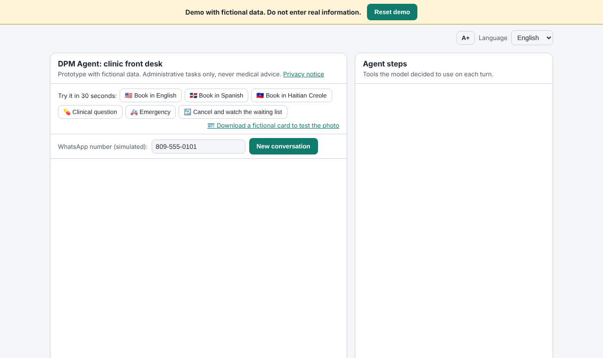
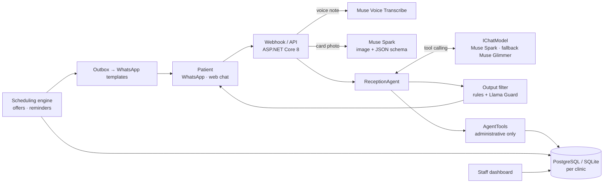

# DPM Agent

*Versión en español: [README.es.md](README.es.md)*

**A WhatsApp front desk for Dominican clinics, built on Meta's Muse models: it books, reschedules and fills cancelled slots in Spanish, English and Haitian Creole — and never gives medical advice.**



<!-- CAPTURA: replace with a GIF of a real conversation with Muse Spark (voice note → booking → waiting-list offer) -->

> Project for the **Meta AI Developer Hackathon** (Oct 26 – Nov 4, 2026), Indie Developer track.

---

## The problem

In many Dominican clinics the schedule runs on WhatsApp and the phone. The receptionist answers the same messages all day ("any slot tomorrow?", "does the doctor work on Saturday?", "I want to change my appointment") while also attending patients in the waiting room, filling in insurance (ARS) forms and taking payments. Messages go unanswered, patients are lost and cancelled slots stay empty.

The country also has a large Haitian community, and many patients write in Kreyòl. Most front-desk tools only speak Spanish.

At the pilot clinic:

| Measure | Value |
|---|---|
| WhatsApp messages per day at the front desk | <!-- CIFRA PILOTO: mensajes de WhatsApp por día --> *pending* |
| Share of those messages that are about appointments | <!-- CIFRA PILOTO: % de mensajes sobre citas --> *pending* |
| Cancelled slots per week that stay empty | <!-- CIFRA PILOTO: huecos por semana sin llenar --> *pending* |
| Patients who write in Kreyòl or English | <!-- CIFRA PILOTO: % de pacientes en kreyòl o inglés --> *pending* |

DPM Agent takes over the repetitive conversation and leaves the staff what truly needs a person.

## What it does

- **Books, reschedules and cancels** over WhatsApp or web chat, with multi-step tool calling (find patient → check availability → confirm → book). The server validates everything: a taken or past slot cannot be booked, even if the model tries.
- **Speaks the patient's language**: Spanish, English and Haitian Creole are guaranteed (fixed texts, WhatsApp templates and tests in all three); any other language is answered as well as possible with English as the fallback. The language is detected on every message and followed if the patient switches.
- **Voice notes** transcribed with Muse Voice Transcribe; the audio is never stored.
- **Insurance card from a photo**: Muse Spark reads name, insurer and member number (image + JSON schema); the result stays pending until the patient or the receptionist confirms it.
- **Fills cancelled slots on its own**: when someone cancels, the first matching patient on the waiting list gets an offer on their channel; if they don't answer in 30 minutes it moves to the next one.
- **Reminder 24 hours before**, with confirm or cancel.
- **Hands everything clinical to a human**: health questions are escalated with the original message and a summary in the dashboard language; a possible emergency gets the clinic's emergency number (911 by default) and an urgent escalation.
- **Staff dashboard**: today's appointments, escalations (urgent first), cards to confirm, insurance authorization drafts (never sent on their own), cost per conversation and per booked appointment, and the audit log; the admin sets the clinic's default language and emergency number. Spanish/English.
- **Multi-clinic**: every record carries its clinic and every query is filtered by it.

## How it uses Meta AI

| Piece | Meta model / product | Where |
|---|---|---|
| Conversation and tool calling | **Muse Spark** (Meta Model API, `/v1/chat/completions`) | `Agent/ReceptionAgent.cs` |
| Reading the insurance card | **Muse Spark**, image input + structured output | `Carnet/MetaLectorCarnet.cs` |
| Voice notes | **Muse Voice Transcribe** | `Voz/MetaTranscriber.cs` |
| Fallback or fully local mode | **Muse Glimmer** (open weights) on vLLM: Modal, Baseten or the clinic's GPU | `Model/`, [docs/GLIMMER.md](docs/GLIMMER.md) |
| Output safety filter | **Llama Guard** (open weights) or the configured Muse model as a classifier | `Seguridad/FiltroSalida.cs` |
| Evaluation judge | **Muse Glimmer** with a written rubric | `tools/DpmAgent.Eval`, [eval/RUBRICA.md](eval/RUBRICA.md) |
| Patient channel | **WhatsApp Cloud API** (signed webhook, templates per language) | `Canales/WhatsApp/`, [docs/WHATSAPP.md](docs/WHATSAPP.md) |

## Results

### Evaluation

144 cases in 15 categories (booking, rescheduling, cancelling, new patient, insurance card, waiting list, clinical question, emergency, prompt injection, someone else's appointment, language switch, off-topic requests, transparency, consent, privacy) in Spanish, English and Haitian Creole, plus French and Portuguese for tier 2. Two layers: deterministic checks on tools and database state, and an LLM judge with a rubric. See [docs/EVALUATION.md](docs/EVALUATION.md).

**Against Muse Spark:**

<!-- RESULTADOS MUSE SPARK: run `dotnet run --project tools/DpmAgent.Eval -- --modelo real` and paste the tables from eval/resultados/ here -->
*Pending: requires access to the Meta Model API.*

**Server guarantees (scripted model, runs in CI on every push):** 144 / 144 cases pass — [latest report](eval/resultados/2026-10-26-modelo-falso.md). Some scripts play a model that obeys an injection on purpose; the server still blocks cancelling someone else's appointment or cancelling without the patient's confirmation. The output filter blocked the 5 scripted replies with doses and the 3 with code (off-topic).

### Cost

Every model call records tokens in and out (never content). Prices are set per model in configuration, never in code. See [docs/COSTS.md](docs/COSTS.md).

| Measure | Muse Spark |
|---|---|
| Average cost per evaluation case | <!-- COSTO MUSE SPARK: columna "Avg cost" del informe real --> *pending* |
| Average cost per booked appointment | <!-- COSTO MUSE SPARK: panel → Costs, tras la prueba piloto --> *pending* |

## Safety

- **No medical advice.** The prompt forbids it in every language, there is no clinical tool, and an **output filter** checks every reply before it is sent (multilingual rules for doses and medications, then Llama Guard or the model as a classifier). A blocked reply is replaced with a safe message, escalated and logged. See [docs/OUTPUT-FILTER.md](docs/OUTPUT-FILTER.md).
- **Emergencies**: the patient is told to call the clinic's emergency number and the staff gets an urgent escalation.
- **Each conversation only acts on its own patient**, identified by the channel's phone number (the WhatsApp sender), never by what the model says. Someone else's appointment looks the same as a non-existent one.
- **Prompt-injection defense on the server**: tool results, transcriptions and text read from photos are data. Cancelling takes two turns controlled by the server; a turn cannot perform more than 3 data-changing actions nor more than 5 tools; appointment reasons only accept administrative values.
- **Privacy**: audio and photos are never stored; logs carry no patient data (tested); conversations are deleted after 30 days (configurable); the receptionist can export or delete a patient's data on request. See [docs/PRIVACY.md](docs/PRIVACY.md).
- **Production basics**: dashboard with secure cookies, hashed passwords and lockout; rate limiting per IP and per conversation; CSP and HSTS; health checks; keys only in environment variables.
- **Fictional data only.** Every patient and doctor in the repository is made up.

## Architecture



```
src/DpmAgent.Api/
  Agent/          ReceptionAgent, AgentTools, sessions
  Idiomas/        language detection, fixed texts in es/en/ht
  Model/          Meta and OpenAI-compatible clients, fallback, usage
  Seguridad/      output filter, rate limiting, health, logs, retention
  Agenda/         waiting list, offers, reminders, outbox, audit log
  Canales/        web chat and WhatsApp Cloud API
  Carnet/ Voz/    insurance card and voice notes
  Panel/ Costos/  staff dashboard and cost view
  Demo/           public demo mode
  Data/ Dpm/      EF Core, migrations per provider, clinic gateway
tools/DpmAgent.Eval/   evaluation runner      eval/   cases, rubric, results
tests/DpmAgent.Tests/  tests with a scripted model (no real calls)
```

(Code identifiers are in Spanish, the project's working language.)

## Try it

**Public demo mode** — banner, six one-click examples (English, Spanish, Kreyòl, clinical question, emergency, cancel with waiting list), the agent's tool trace, and a reset button that only touches the demo clinic. See [docs/DEMO.md](docs/DEMO.md).

```bash
export META_API_KEY="your-key"
export Demo__Habilitado=true
dotnet run --project src/DpmAgent.Api
```

**Docker Compose** — app + PostgreSQL, with an optional profile that runs Muse Glimmer on a local GPU. See [docs/INSTALLATION.md](docs/INSTALLATION.md).

```bash
cp .env.example .env    # META_API_KEY, POSTGRES_PASSWORD, Panel__ClaveInicial
docker compose up -d --build
# with local Muse Glimmer:
docker compose --profile glimmer up -d --build
```

**Tests and evaluation** (no key needed):

```bash
dotnet test
dotnet run --project tools/DpmAgent.Eval            # scripted model
dotnet run --project tools/DpmAgent.Eval -- --modelo real   # Muse Spark + judge
```

With a Meta key, `./scripts/probar-meta.sh` and `dotnet test --filter "Categoria=Meta"` check the real formats ([docs/META-API-TESTING.md](docs/META-API-TESTING.md)). The PostgreSQL test runs when `DPM_TEST_POSTGRES` holds a throwaway database (CI provides one).

Every setting, with its default, is listed in [.env.example](.env.example). Third-party components and their licenses: [THIRD_PARTY_NOTICES.md](THIRD_PARTY_NOTICES.md) (checked in CI). Cloud deployment to Azure App Service with PostgreSQL and GitHub Actions: [docs/DEPLOYMENT.md](docs/DEPLOYMENT.md).

## What existed before the event and what was built during it

**Before October 26, 2026:** DPM, my clinic management system (a separate private repository). That system is **not** part of this submission or the demo, and no code was copied from it.

**During the hackathon (everything in this repository):** the agent and its tools, the Meta Model API clients, multilingual support, voice notes, insurance-card reading, the waiting list and reminders, WhatsApp, the staff dashboard, the output filter, the evaluation bank, cost tracking, the public demo, Docker Compose and the tests. The commit history starts on October 26, 2026.

## License

MIT
