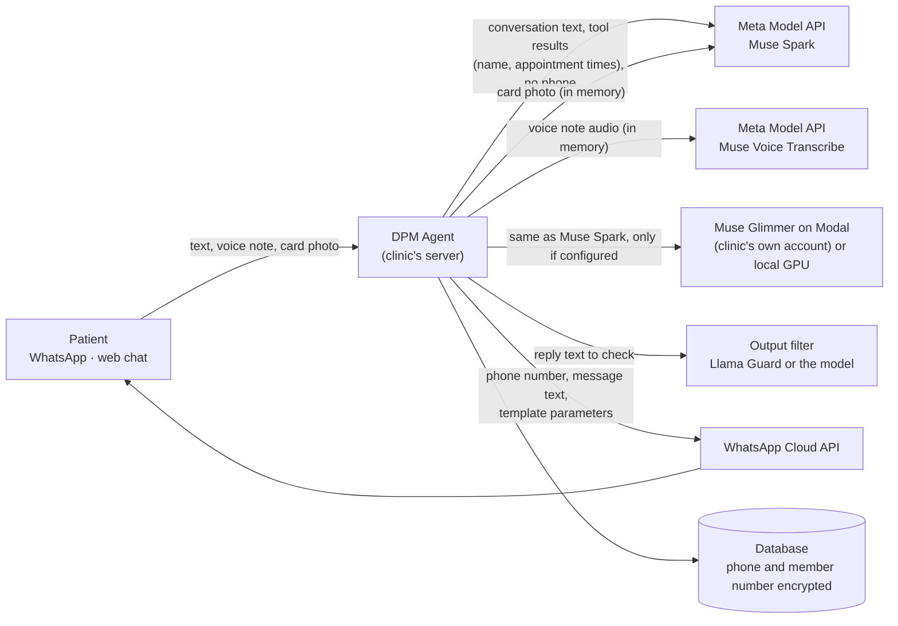

# Security architecture

*Versión en español: [es/ARQUITECTURA-SEGURIDAD.md](es/ARQUITECTURA-SEGURIDAD.md)*

How DPM Agent protects the browser pages, the API and the data. Paths are relative to the repository root.

## Browser protections

Every response (pages and API) carries these headers, set in `src/DpmAgent.Api/Seguridad/EncabezadosSeguridad.cs`:

| Header | Value | Why |
|---|---|---|
| `Content-Security-Policy` | `default-src 'self'; script-src 'self'; style-src 'self'; img-src 'self' data: blob:; media-src 'self' blob:; connect-src 'self'; object-src 'none'; frame-ancestors 'none'; base-uri 'self'; form-action 'self'` | No `unsafe-inline`: every script and style lives in its own file under `wwwroot/`, so injected markup cannot run code. Nothing can embed the pages, load plugins, change the base URL or post forms elsewhere. |
| `X-Frame-Options` | `DENY` | Clickjacking protection for older browsers. |
| `Permissions-Policy` | `microphone=(self)` only on the chat page (`/`), `microphone=()` everywhere else; camera, geolocation, payment, USB and motion sensors always off | The chat records voice notes; the dashboard never needs the microphone. |
| `Cross-Origin-Opener-Policy` | `same-origin` | Another site opened in a popup cannot keep a handle on these pages. |
| `X-Content-Type-Options`, `Referrer-Policy` | `nosniff`, `no-referrer` | No MIME sniffing; no URL leaks to other sites. |
| `Strict-Transport-Security` | outside development | HTTPS only. |

CI checks it twice: `tests/DpmAgent.Tests/SeguridadNavegadorTests.cs` asserts the headers and that the pages have no inline scripts, styles, event attributes or `javascript:` URLs; `tests/accesibilidad/auditar.mjs` opens the demo (and uses an example), the dashboard tabs and the privacy notice in Chromium and fails on any CSP violation or JavaScript error in the console.

## Cross-site requests

- **CSRF.** The dashboard cookie is `HttpOnly`, `Secure` and `SameSite=Strict`. On top of that, every request that changes data under `/api/panel`, `/api/bitacora`, `/api/carnets` and `/api/auth` (POST, PUT, PATCH, DELETE) must carry an `Origin` header (or, if the browser omits it, a `Referer`) from the same scheme, host and port; otherwise it gets `403`. A request with neither is rejected too. See `ProteccionCsrf` in `Seguridad/EncabezadosSeguridad.cs`.
- **No CORS.** The API does not enable CORS: it never sends `Access-Control-Allow-Origin`, so a page on another origin cannot read its responses, and preflight requests from other origins get no permission. The chat, the demo and the dashboard are served from the same origin as the API, so they do not need it. If a clinic ever needs a separate front end, it should be served from the same domain (reverse proxy) rather than opening CORS. Tested in `SeguridadNavegadorTests`.
- **Webhook.** `/api/whatsapp/webhook` has no cookie and is not covered by the origin check: every call must carry Meta's `X-Hub-Signature-256` HMAC (see [WHATSAPP.md](WHATSAPP.md)).

## Dashboard access

- **Passwords**: PBKDF2 hashes (ASP.NET Core `PasswordHasher`); at least 12 characters, not a common password or a variation of one (Spanish and clinic-specific words included), no sequences and not containing the username (`Panel/PoliticaClaves.cs`). A password set by someone else (the initial one, or a user created by an admin) must be changed at the first sign-in: until then the session can only change it. A stored password that no longer meets the policy is flagged for change at the next sign-in. The public demo user is the only exception: its password is shown on the demo page and cannot be changed.
- **Sessions**: `HttpOnly`, `Secure`, `SameSite=Strict` cookie that expires after 30 minutes without activity (`Panel__MinutosInactividad`) and always after 8 hours (`Panel__HorasMaximasSesion`). Each session carries a security stamp; changing the password or the second factor changes it, which signs out every other session of that user on its next request. A deactivated user is signed out the same way.
- **Sign-in**: the same answer for an unknown user, a wrong password, a locked or inactive account; a password hash is always computed so the timing does not reveal which users exist. Per-user lockout (5 failures, 15 minutes) plus a per-IP rate limit on sign-in, password change and second-factor endpoints.
- **Second factor (TOTP)**: optional for administrators, required for all of them if the clinic turns it on (dashboard → Data access log). Standard RFC 6238 codes (any authenticator app); the secret is stored encrypted with the Data Protection API, a code cannot be reused and a wrong code counts as a failed attempt.
- **Data access log**: who viewed a patient's record, exported or deleted their data: only the staff username, the action, the patient id and the time, never personal data. Only administrators see it (dashboard → Data access log).

Tests: `tests/DpmAgent.Tests/SesionesPanelTests.cs`.

## Data at rest

- **Field-level encryption.** The patient's phone number and insurance member number are encrypted in the database with the ASP.NET Core Data Protection API (`Data/CifradoCampos.cs`, an EF Core value converter): the column holds `dpm1:` plus the protected text, never the number. Because protected text changes on every write, lookups by phone use a separate `TelefonoHash` column: an HMAC-SHA256 of the normalized number. The HMAC key is random, stored in the `SecretosApp` table and itself protected with Data Protection. Patients stored before this version are encrypted on startup, after the migrations (`CifrarExistentesAsync`).
- **The keys must survive restarts.** The same Data Protection keys encrypt the dashboard cookie, the TOTP secrets, the patient fields and the HMAC key: losing them means those fields can no longer be read. In production the app refuses to start unless the keys are persisted: `DataProtection__Ruta` pointing to a volume (Docker Compose does it), or Azure App Service, which keeps them on its own. Back up that folder with the database.
- **What stays in clear, and why.** Channel tables (conversations, outgoing and incoming WhatsApp messages, consent records) keep the phone number the message is sent to: the WhatsApp Cloud API needs it, and those rows are deleted after 30 days (`Retencion__*`). Names stay in clear because the receptionist searches and reads them every day.

## Data in transit

- **PostgreSQL over TLS.** In production the app does not start if `ConnectionStrings__Dpm` does not require TLS (`SSL Mode=Require`, `VerifyCA` or `VerifyFull`). Azure Database for PostgreSQL enforces TLS. The Docker Compose database starts with TLS and a certificate generated for each installation on first start (`docker/postgres/iniciar-con-tls.sh`); CI checks a real TLS connection to it.
- **HTTPS** with HSTS outside development; every external API is called over HTTPS.
- **Audio and photos** are read into memory with a size limit (the multipart buffer threshold equals the limit, so ASP.NET never writes them to a temporary file), sent to the model and dropped; no table, file or log keeps them. A test uploads a 320 KB voice note and card photo, also with the transcription service failing, and checks that no temporary file appeared and that their bytes are in no table.

## What leaves the server, and why

| Service | What it receives | Why | What it does not receive |
|---|---|---|---|
| Meta Model API, Muse Spark | The conversation (patient and agent messages), tool results (patient name, appointment times, doctor), the system prompt | To understand the request and decide which tool to call | The phone number (the server identifies the patient; in the doctor's channel the model only sees the last 4 digits to tell namesakes apart), the member number, data of other patients |
| Meta Model API, Muse Voice Transcribe | The voice note audio | To transcribe it | Who sent it |
| Meta Model API, card reading | The card photo | To read name, insurer and member number for the patient to confirm | Anything else of the patient |
| Muse Glimmer (Modal, Baseten or the clinic's GPU) | The same as Muse Spark, only if configured as fallback or local model | Availability, or keeping everything in the clinic | Same exclusions; on the clinic's GPU nothing leaves the clinic |
| Output filter (Llama Guard or the configured model) | The agent's reply before it is sent | To block medical advice or off-topic content | The patient's identity |
| WhatsApp Cloud API | The patient's phone number, the message text, template name and parameters | To deliver the message | Anything not in the message |

API keys go only in environment variables or Key Vault references (see [DEPLOYMENT.md](DEPLOYMENT.md)); the logs never contain phone numbers or patient text (tested).
