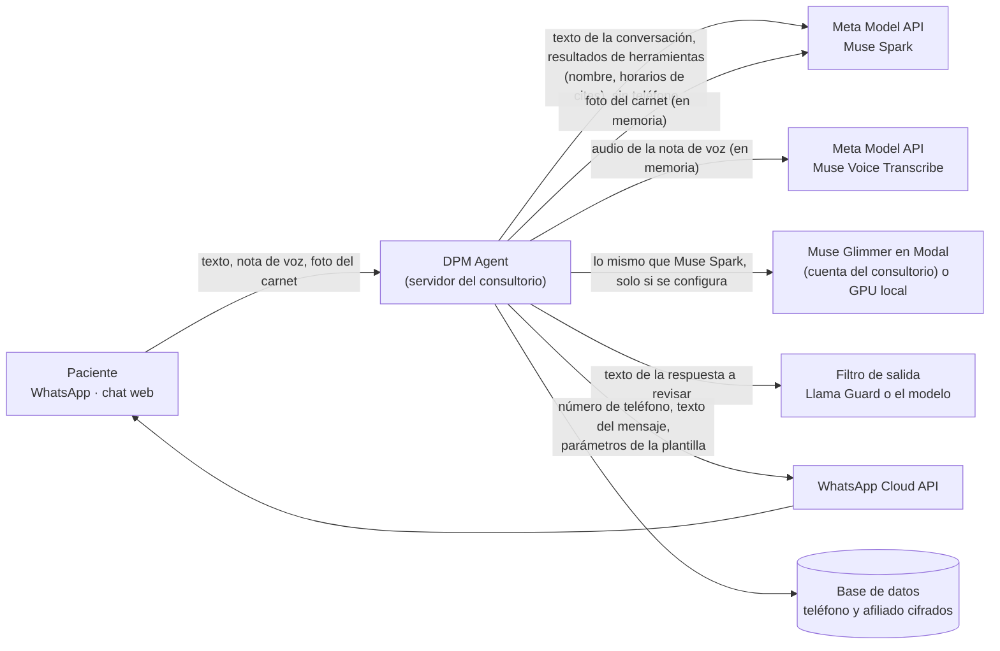

# Arquitectura de seguridad

*English version: [../SECURITY-ARCHITECTURE.md](../SECURITY-ARCHITECTURE.md)*

Cómo DPM Agent protege las páginas del navegador, la API y los datos. Las rutas son relativas a la raíz del repositorio.

## Protección del navegador

Cada respuesta (páginas y API) lleva estas cabeceras, definidas en `src/DpmAgent.Api/Seguridad/EncabezadosSeguridad.cs`:

| Cabecera | Valor | Por qué |
|---|---|---|
| `Content-Security-Policy` | `default-src 'self'; script-src 'self'; style-src 'self'; img-src 'self' data: blob:; media-src 'self' blob:; connect-src 'self'; object-src 'none'; frame-ancestors 'none'; base-uri 'self'; form-action 'self'` | Sin `unsafe-inline`: cada script y estilo está en su propio archivo en `wwwroot/`, así que un HTML inyectado no puede ejecutar código. Nadie puede incrustar las páginas, cargar complementos, cambiar la URL base ni enviar formularios a otro sitio. |
| `X-Frame-Options` | `DENY` | Protección contra clickjacking en navegadores viejos. |
| `Permissions-Policy` | `microphone=(self)` solo en la página del chat (`/`), `microphone=()` en el resto; cámara, ubicación, pagos, USB y sensores siempre apagados | El chat graba notas de voz; el panel nunca necesita el micrófono. |
| `Cross-Origin-Opener-Policy` | `same-origin` | Otro sitio abierto en una ventana emergente no conserva acceso a estas páginas. |
| `X-Content-Type-Options`, `Referrer-Policy` | `nosniff`, `no-referrer` | Sin adivinar tipos MIME; las URL no se filtran a otros sitios. |
| `Strict-Transport-Security` | fuera de desarrollo | Solo HTTPS. |

El CI lo comprueba dos veces: `tests/DpmAgent.Tests/SeguridadNavegadorTests.cs` verifica las cabeceras y que las páginas no tengan scripts, estilos, atributos de eventos ni URL `javascript:` en línea; `tests/accesibilidad/auditar.mjs` abre la demo (y usa un ejemplo), las pestañas del panel y el aviso de privacidad en Chromium y falla ante cualquier violación de la CSP o error de JavaScript en la consola.

## Peticiones entre sitios

- **CSRF.** La cookie del panel es `HttpOnly`, `Secure` y `SameSite=Strict`. Además, toda petición que cambia datos en `/api/panel`, `/api/bitacora`, `/api/carnets` y `/api/auth` (POST, PUT, PATCH, DELETE) debe traer una cabecera `Origin` (o, si el navegador no la manda, un `Referer`) con el mismo esquema, host y puerto; si no, recibe `403`. Una petición sin ninguna de las dos también se rechaza. Ver `ProteccionCsrf` en `Seguridad/EncabezadosSeguridad.cs`.
- **Sin CORS.** La API no habilita CORS: nunca envía `Access-Control-Allow-Origin`, así que una página de otro origen no puede leer sus respuestas, y las peticiones previas (preflight) de otros orígenes no reciben permiso. El chat, la demo y el panel se sirven desde el mismo origen que la API, así que no lo necesitan. Si un consultorio necesitara otra interfaz, debe servirse desde el mismo dominio (proxy inverso) en vez de abrir CORS. Probado en `SeguridadNavegadorTests`.
- **Webhook.** `/api/whatsapp/webhook` no usa cookie y no pasa por la revisión de origen: cada llamada debe traer la firma HMAC `X-Hub-Signature-256` de Meta (ver [WHATSAPP.md](WHATSAPP.md)).

## Acceso al panel

- **Claves**: hash PBKDF2 (`PasswordHasher` de ASP.NET Core); al menos 12 caracteres, que no sea una clave común ni una variante (incluye palabras en español y propias de un consultorio), sin secuencias y sin el nombre de usuario (`Panel/PoliticaClaves.cs`). Una clave que puso otra persona (la inicial, o un usuario creado por un admin) se cambia en el primer inicio de sesión: hasta entonces la sesión solo puede cambiarla. Una clave guardada que ya no cumple la política queda marcada para cambiarla al entrar. La única excepción es el usuario de la demo pública: su clave se muestra en la página de la demo y no se puede cambiar.
- **Sesiones**: cookie `HttpOnly`, `Secure`, `SameSite=Strict` que vence tras 30 minutos sin actividad (`Panel__MinutosInactividad`) y siempre a las 8 horas (`Panel__HorasMaximasSesion`). Cada sesión lleva un sello de seguridad; cambiar la clave o el segundo factor lo cambia, y eso cierra todas las demás sesiones de ese usuario en su siguiente petición. A un usuario desactivado le pasa lo mismo.
- **Inicio de sesión**: la misma respuesta para un usuario inexistente, una clave equivocada o una cuenta bloqueada o inactiva; siempre se calcula un hash de clave para que el tiempo tampoco revele qué usuarios existen. Bloqueo por usuario (5 fallos, 15 minutos) y además límite por IP en el inicio de sesión, el cambio de clave y el segundo factor.
- **Segundo factor (TOTP)**: opcional para los administradores, obligatorio para todos ellos si el consultorio lo activa (panel → Accesos a datos). Códigos estándar RFC 6238 (cualquier aplicación autenticadora); el secreto se guarda cifrado con la Data Protection API, un código no se puede reutilizar y un código equivocado cuenta como intento fallido.
- **Bitácora de acceso a datos**: quién vio la ficha de un paciente, exportó o borró sus datos: solo el usuario del personal, la acción, el id del paciente y la hora, nunca datos personales. Solo la ven los administradores (panel → Accesos a datos).

Pruebas: `tests/DpmAgent.Tests/SesionesPanelTests.cs`.

## Datos en reposo

- **Cifrado a nivel de campo.** El teléfono del paciente y su número de afiliado se guardan cifrados con la Data Protection API de ASP.NET Core (`Data/CifradoCampos.cs`, un conversor de EF Core): la columna guarda `dpm1:` más el texto protegido, nunca el número. Como el texto protegido cambia en cada escritura, la búsqueda por teléfono usa otra columna, `TelefonoHash`: un HMAC-SHA256 del número normalizado. La llave del HMAC es aleatoria, está en la tabla `SecretosApp` y a su vez protegida con Data Protection. Los pacientes guardados antes de esta versión se cifran al arrancar, después de las migraciones (`CifrarExistentesAsync`).
- **Las llaves deben sobrevivir a los reinicios.** Las mismas llaves de Data Protection cifran la cookie del panel, los secretos TOTP, los campos del paciente y la llave del HMAC: si se pierden, esos campos ya no se pueden leer. En producción la app no arranca si las llaves no son persistentes: `DataProtection__Ruta` apuntando a un volumen (Docker Compose lo hace) o Azure App Service, que las guarda por su cuenta. Respalde esa carpeta junto con la base.
- **Qué queda en claro y por qué.** Las tablas del canal (conversaciones, mensajes de WhatsApp enviados y recibidos, registros de consentimiento) guardan el número al que se envía el mensaje: la WhatsApp Cloud API lo necesita, y esas filas se borran a los 30 días (`Retencion__*`). Los nombres quedan en claro porque la secretaria los busca y los lee todos los días.

## Datos en tránsito

- **PostgreSQL con TLS.** En producción la app no arranca si `ConnectionStrings__Dpm` no exige TLS (`SSL Mode=Require`, `VerifyCA` o `VerifyFull`). Azure Database for PostgreSQL exige TLS. La base de Docker Compose arranca con TLS y un certificado generado para cada instalación la primera vez (`docker/postgres/iniciar-con-tls.sh`); el CI comprueba una conexión TLS real.
- **HTTPS** con HSTS fuera de desarrollo; todas las API externas se llaman por HTTPS.
- **Audio y fotos** se leen en memoria con un límite de tamaño (el umbral del buffer multipart es igual al límite, así que ASP.NET nunca los escribe en un archivo temporal), se envían al modelo y se descartan; ninguna tabla, archivo o log los guarda. Una prueba sube una nota de voz y una foto de carnet de 320 KB, también con el servicio de transcripción fallando, y comprueba que no apareció ningún temporal y que sus bytes no están en ninguna tabla.

## Qué sale del servidor y por qué

| Servicio | Qué recibe | Por qué | Qué no recibe |
|---|---|---|---|
| Meta Model API, Muse Spark | La conversación (mensajes del paciente y del agente), resultados de herramientas (nombre del paciente, horarios, médico), el prompt del sistema | Para entender el pedido y decidir qué herramienta usar | El teléfono (el servidor identifica al paciente; en el canal del médico el modelo solo ve los últimos 4 dígitos para distinguir homónimos), el número de afiliado, datos de otros pacientes |
| Meta Model API, Muse Voice Transcribe | El audio de la nota de voz | Para transcribirla | Quién la envió |
| Meta Model API, lectura del carnet | La foto del carnet | Para leer nombre, ARS y afiliado y que el paciente los confirme | Nada más del paciente |
| Muse Glimmer (Modal, Baseten o la GPU del consultorio) | Lo mismo que Muse Spark, solo si se configura como respaldo o modelo local | Disponibilidad, o que todo quede en el consultorio | Las mismas exclusiones; en la GPU del consultorio nada sale de él |
| Filtro de salida (Llama Guard o el modelo configurado) | La respuesta del agente antes de enviarla | Para bloquear consejo médico o temas ajenos | La identidad del paciente |
| WhatsApp Cloud API | El teléfono del paciente, el texto del mensaje, el nombre y los parámetros de la plantilla | Para entregar el mensaje | Nada que no esté en el mensaje |

Las claves de API van solo en variables de entorno o referencias a Key Vault (ver [DESPLIEGUE.md](DESPLIEGUE.md)); los logs nunca llevan teléfonos ni texto de pacientes (probado).

## Secretos y cadena de suministro

- **Secretos** solo en variables de entorno o referencias a Key Vault, nunca en el repositorio; la rotación de la clave de Meta y del app secret de WhatsApp está en [DESPLIEGUE.md](DESPLIEGUE.md#secretos-referencias-a-key-vault-y-rotación). El CI revisa **todo el historial de git** con gitleaks en cada push y falla ante cualquier hallazgo (`.gitleaks.toml` solo admite las claves ficticias de las pruebas automáticas).
- **Dependencias**: Dependabot (`.github/dependabot.yml`) para NuGet, GitHub Actions, el Dockerfile, las imágenes de Docker Compose y las herramientas de la prueba de accesibilidad; licencias verificadas en el CI (`scripts/licencias.py`).
- **Análisis estático**: CodeQL para C# y JavaScript en cada push y cada semana (`.github/workflows/codeql.yml`, consultas `security-extended`).
- **Imagen de contenedor**: el CI construye la imagen Docker y la revisa con Trivy; falla ante vulnerabilidades críticas o altas que tengan arreglo. La imagen corre con un usuario sin privilegios.
- **Workflows**: cada acción está fijada a un SHA de commit (con la versión en un comentario, que Dependabot actualiza), los escáneres corren desde imágenes fijadas por digest y cada workflow declara permisos mínimos (`contents: read`; CodeQL agrega `security-events: write` y el despliegue a Azure `id-token: write` para OIDC, sin contraseñas guardadas).
